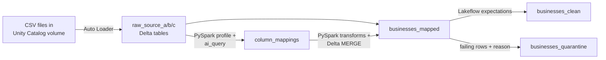
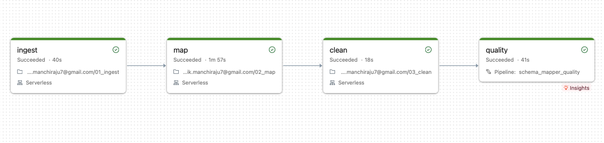
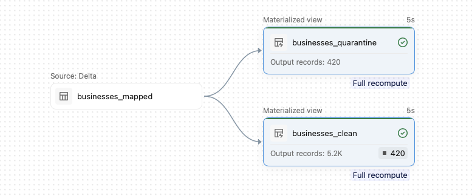
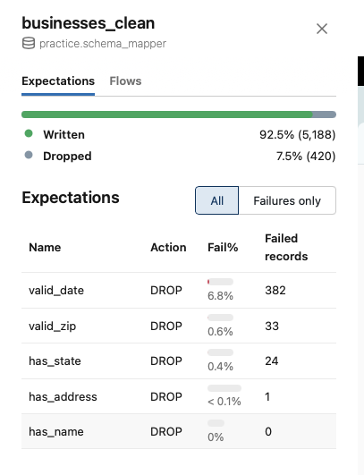
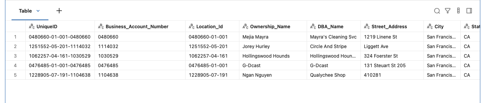
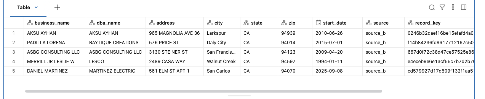
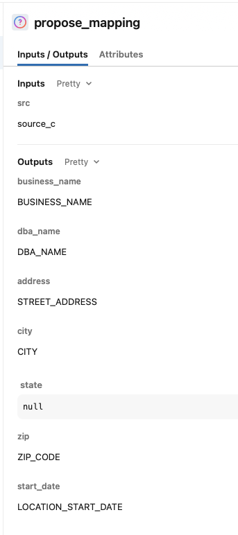

# Schema-Mapping Pipeline on Databricks

Three cities publish the same kind of record, a registered business, with different column names, date formats and gaps. This pipeline loads all three, uses an LLM to map each file's columns to one target schema, cleans and merges the result into a single Delta table, and quarantines rows that fail data-quality rules, with the reason recorded.

Built on Databricks Free Edition as a hands-on exercise with the platform.

**Stack:** Unity Catalog volumes and tables, Auto Loader, PySpark, `ai_query` with `databricks-meta-llama-3-3-70b-instruct`, MLflow tracing, Delta Lake `MERGE`, Lakeflow Spark Declarative Pipelines (expectations), Lakeflow Jobs.

## Architecture



The four stages run as one Lakeflow Job: `ingest → map → clean → quality`.



## Data

| Folder | Source | Rows used |
|---|---|---|
| `source_a` | [Chicago Business Licenses – Current Active](https://data.cityofchicago.org/Community-Economic-Development/Business-Licenses-Current-Active/uupf-x98q) | 2,000 |
| `source_b` | [San Francisco Registered Business Locations](https://data.sfgov.org/Economy-and-Community/Registered-Business-Locations-San-Francisco/g8m3-pdis) | 2,000 |
| `source_c` | [Los Angeles Listing of Active Businesses](https://data.lacity.org/Administration-Finance/Listing-of-Active-Businesses/6rrh-rzua) | 2,000 |

Target schema: `business_name, dba_name, address, city, state, zip, start_date`.

## How it works

1. **Ingest** (`01_ingest.py`): Auto Loader reads each source folder with `availableNow`, normalizes column names, and writes a raw Delta table. Checkpoints mean re-runs only pick up new files.
2. **Map** (`02_map.py`): PySpark profiles each source's columns with sample values. `ai_query` asks the model to map each target field to one source column and return JSON. Each call is traced in MLflow, and the mappings are stored in a table.
3. **Clean** (`03_clean.py`): applies the mappings, standardizes names, zips and dates, fills known defaults with rules rather than the model (LA has no state column, so `state` is set to `CA`), deduplicates, and writes with a Delta `MERGE` keyed on a hash of name, address and zip.
4. **Quality** (`04_quality_pipeline.py`): a Lakeflow pipeline applies five expectations. Passing rows go to `businesses_clean`; failing rows go to `businesses_quarantine` with the names of the rules they broke.

## Results

| Measure | Value |
|---|---|
| Rows loaded | 6,000 |
| After deduplication | 5,608 (Chicago 1,628, SF 1,988, LA 1,992) |
| Passed all quality rules | 5,188 (92.5%) |
| Quarantined | 420 (7.5%) |
| Column mappings judged correct | 20 of 21 |
| Re-running the merge | Row counts unchanged |
| End-to-end job runtime | 3 min 41 s |

Chicago fell from 2,000 to 1,628 rows because it issues a separate license per business activity, so one business at one address appears several times.





### Before and after (San Francisco)





### MLflow trace of a mapping call



## What the quality checks caught

All 382 rows that failed `valid_date` came from Chicago. The model mapped Chicago's `LICENSE_TERM_START_DATE` to `start_date`, but that column is the start of the current license term, which can be in the future after a renewal, not the date the business opened. The pipeline quarantined these rows instead of letting them into the clean table.

The model's other choices held up. It correctly returned no match for `state` in the LA file, which has no state column, rather than guessing one.

The 24 San Francisco rows with no state are genuine: SF's registry includes businesses whose registered address is outside the city, and some have the state left blank. They are quarantined rather than defaulted to `CA`.

## What I would change next

- Give the model a one-line description of each target field, not just its name, so it can tell a business start date from a license term date.
- Add a human review step for low-confidence mappings before they are applied.
- Score mapping accuracy against hand-labeled answers on more sources.

## Repository layout

```
01_ingest.py
02_map.py
03_clean.py
04_quality_pipeline.py
screenshots/
README.md
```

To run it: create the schema and volume, upload one CSV per `incoming/source_x` folder, set `CATALOG` at the top of each notebook, create the pipeline from `04_quality_pipeline.py`, and run the four steps as a job.
